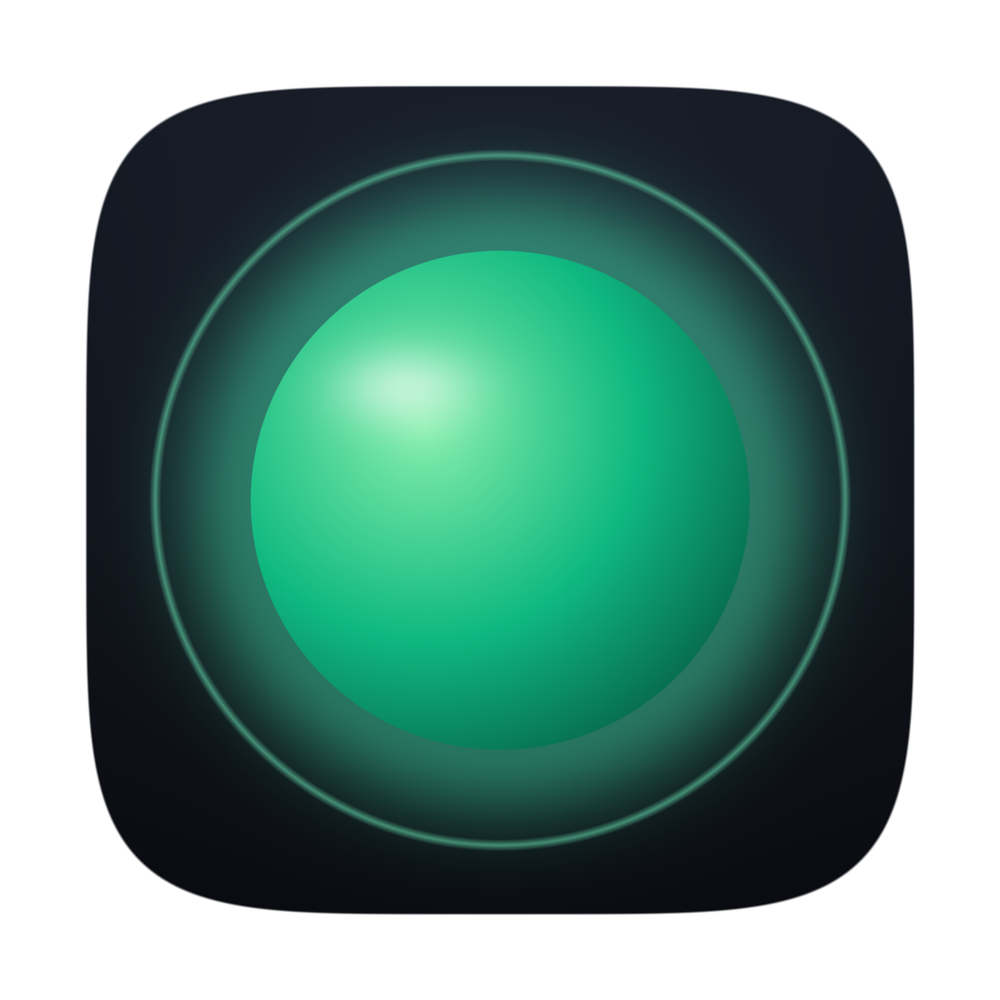
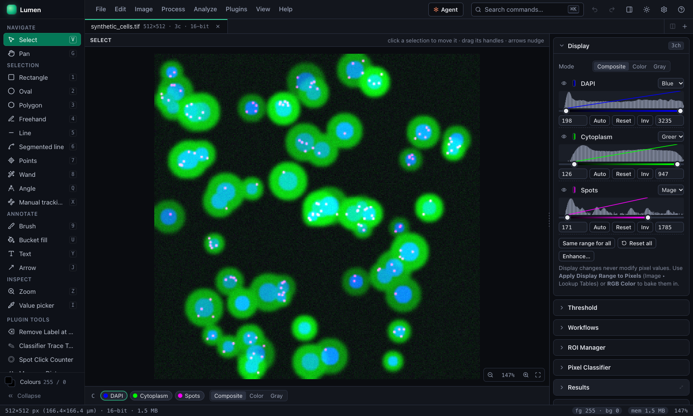
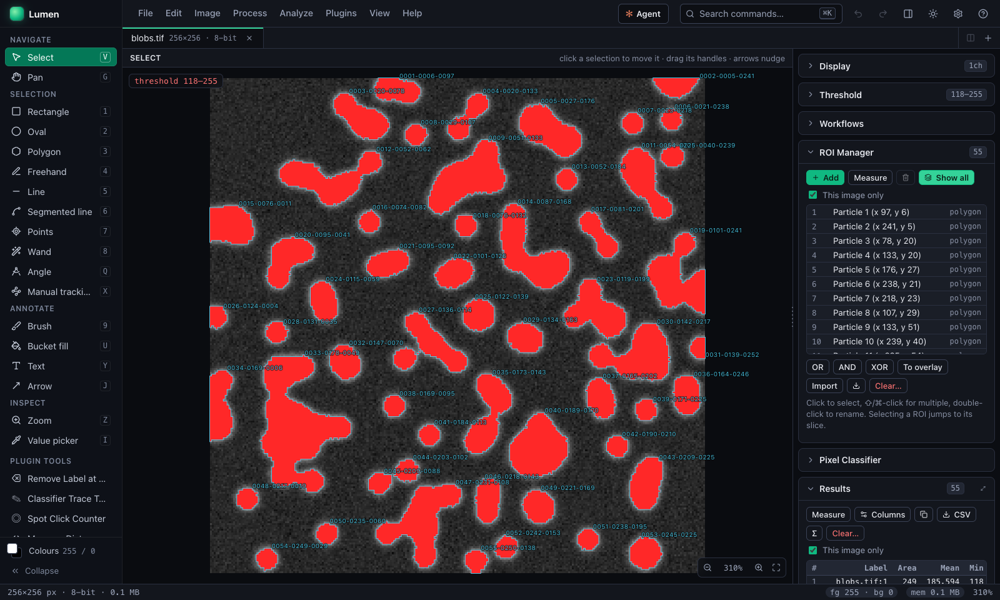
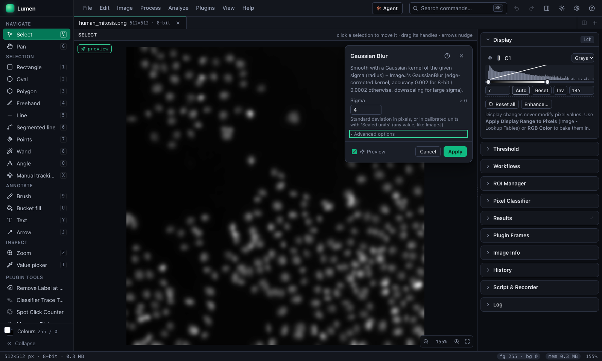
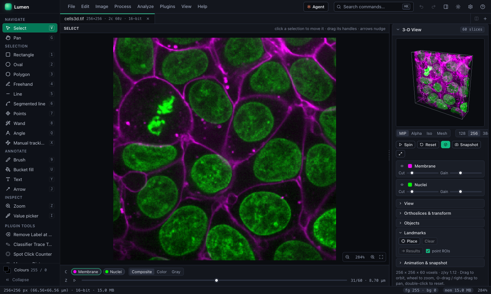
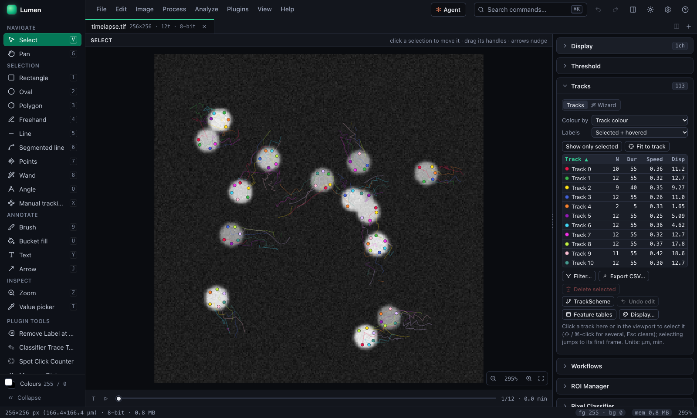
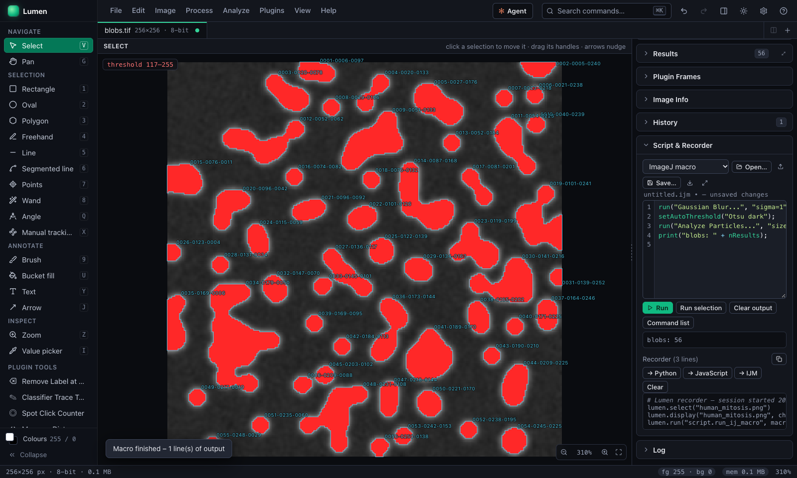
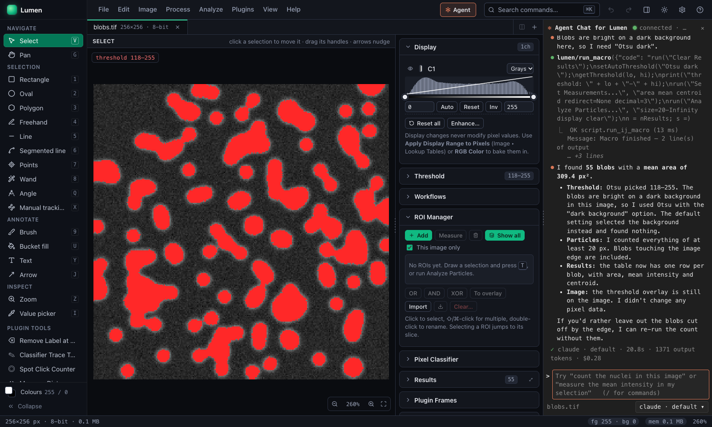
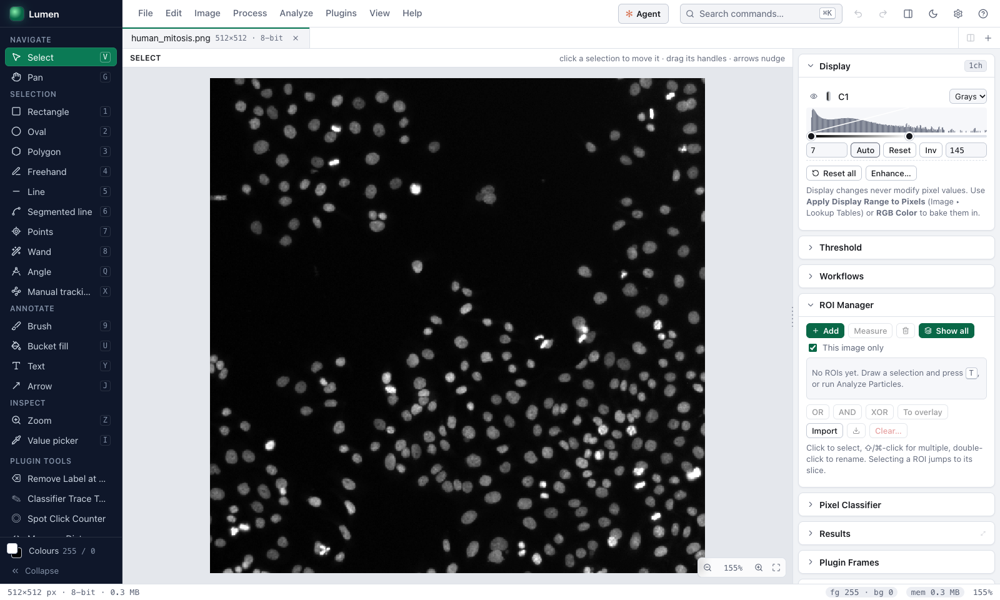

<div align="center">



# Lumen

**The ImageJ / Fiji toolbox in one modern window: open, filter, threshold, measure, track and script your images, and run your Fiji macros as they are.**

503 commands that cover every Fiji menu: live previews, per-channel display with histograms, a docked ROI Manager and
Results table, 3-D volume rendering, TrackMate-style tracking, a Weka-style pixel classifier, deep undo, and a macro
recorder that writes Python or ImageJ macros. A desktop app for macOS, Windows and Linux, with an AI agent built in.

[](https://github.com/Jetzu/Lumen/actions/workflows/ci.yml)
[](https://github.com/Jetzu/Lumen/actions/workflows/desktop-release.yml)


[](LICENSE.md)

</div>

```bash
lumen cells.czi other.tif        # any microscopy file, several at once, or nothing
```

<p align="center"></p>

Every screenshot in this README was rendered by Lumen itself, using its bundled sample images.
[docs/make_gallery.py](docs/make_gallery.py) regenerates them.

## Gallery

### Threshold and count

> *Threshold the blobs with Otsu, then count them with Analyze Particles.*

The threshold panel shows the selected range in red as you drag. Lumen has the 16 global auto-threshold methods and 7
local ones. Analyze Particles filters by size and circularity, fills the Results table and adds every particle to the
ROI Manager. The numbers match ImageJ's.

<p align="center"></p>

### Find any command, see the result before you apply it

> *Press ⌘K, type "gauss", and drag the sigma while the image updates.*

The command palette finds any of the 503 commands by name, by ImageJ name or by keyword. Commands with parameters open
a sheet beside the image, with a live preview. Apply records one undo step.

<p align="center"></p>

### Hyperstacks and 3-D

> *Look at a two-channel confocal stack slice by slice, and as a volume.*

Images are 5-D (time, Z, channel, Y, X). Channels have their own LUTs, contrast and visibility, and you can view them
as a composite. Z and T sliders play stacks back. The 3-D view renders the volume (MIP, translucent, iso-surface or
mesh) next to the slice, with orthogonal views, landmarks and turntable animations.

<p align="center"></p>

### Tracking

> *Detect and link the nuclei of a time-lapse, then look at the tracks.*

TrackMate-style spot detection (LoG, DoG or local maxima) and LAP linking with gap closing, splitting and merging. A
step-by-step wizard, a TrackScheme lineage view, per-track statistics, and TrackMate XML import and export.

<p align="center"></p>

### Macros and scripts

> *Run an ImageJ macro from Fiji unchanged, and get every click back as a script.*

The script editor runs ImageJ macros (466 `run("…")` command names and 172 macro functions), Python and Jython (with an
`ij` shim), JavaScript, and, through the optional Java bridge, Groovy, BeanShell and JRuby. The recorder writes
everything you do as a replayable Python script or ImageJ macro.

<p align="center"></p>

### Agent Chat

> *"Count the blobs in this image and tell me their mean area."*

Click **✻ Agent** in the top bar and ask in plain language. Your own Claude Code or Codex works in the window you are
looking at, through Lumen's MCP tools: it thresholds, measures and explains what it did. Every step appears in the
window and can be undone.

<p align="center"></p>

### Light and dark

<p align="center"></p>

## What it can do

| | |
|---|---|
| **Open** | TIFF / OME-TIFF (ImageJ hyperstacks with calibration and LUTs), ND2, CZI, LIF, OIB / OIF, LSM, DICOM, NIfTI, MRC, HDF5 / Imaris, OME-Zarr, whole-slide pyramids, Gatan DM3 / DM4, Zeiss ZVI, video, image sequences; every other format through the optional Bio-Formats bridge; virtual stacks for data larger than RAM |
| **Display** | per-channel min / max with histograms, 60 LUTs (the full Fiji set), composite / colour / gray, Z and T playback, split view with linked zoom, orthogonal views, 3-D volume and mesh rendering |
| **Process** | Gaussian, median, rank and 3-D filters, unsharp mask, CLAHE, background subtraction, FFT, image calculator, math, noise, binary operations, watershed, distance maps, skeletons |
| **Segment** | 16 global and 7 local thresholds, Weka-style pixel classifier (2-D and 3-D), random walker, active contours, superpixels, MorphoLibJ-style label tools, Cellpose / StarDist bridges |
| **Measure** | ImageJ's measurement sets (Feret, shape descriptors, ellipse fits), Analyze Particles, Find Maxima, colocalisation (Costes, Manders), skeleton analysis, directionality, curve fitting, line profiles |
| **Track and register** | TrackMate-style tracking with lineage, manual tracking, kymographs; stack alignment (StackReg / SIFT / phase correlation), bUnwarpJ-style elastic registration, Grid / Collection stitching |
| **Automate** | macro recorder (Python, JavaScript, ImageJ macro), batch processing of folders, guided workflows (count nuclei, track cells …), plugins as `.py` files, a REST and WebSocket API |
| **Ask** | Agent Chat in the window, and an MCP server with 45 tools for Claude Code, Codex and Claude Desktop |

Everything is undoable, with deep, memory-bounded undo and a visible history. Every command is listed with its
parameters in [docs/COMMANDS.md](docs/COMMANDS.md), and [docs/FIJI_PARITY.md](docs/FIJI_PARITY.md) maps every Fiji menu
command to Lumen.

## Install

**Desktop app.** Download it from the [latest release](https://github.com/Jetzu/Lumen/releases/latest):

| System | File | How |
|---|---|---|
| macOS (Apple silicon / Intel) | `Lumen-<version>-macos-arm64.dmg` / `-macos-x86_64.dmg` | open it and drag **Lumen** onto **Applications** |
| Windows 10 / 11 | `Lumen-<version>-windows-x86_64.zip` | unzip anywhere and run `Lumen\Lumen.exe` |
| Linux (x86_64) | `Lumen-<version>-linux-x86_64.AppImage` or `.tar.gz` | make the AppImage executable and run it |

The apps are not notarised or code-signed by a paid developer account. The first time you open a downloaded copy:
- **macOS:** right-click **Lumen**, choose **Open**, then **Open** again (or run `xattr -dr com.apple.quarantine /Applications/Lumen.app`).
- **Windows:** in SmartScreen, choose **More info**, then **Run anyway**.

To build the app yourself (`python3 desktop/build.py`), see [docs/DESKTOP.md](docs/DESKTOP.md).

**From source (any platform).** Requires Python 3.11 or newer.

```bash
git clone https://github.com/Jetzu/Lumen.git && cd Lumen
python3 -m venv .venv && .venv/bin/pip install -e ".[formats]"
.venv/bin/lumen                       # opens Lumen in your browser at http://127.0.0.1:8765
```

On Windows use `py -3 -m venv .venv`, then `.venv\Scripts\pip install -e ".[formats]"` and `.venv\Scripts\lumen`. You
can also run `scripts\run_lumen.bat` (`scripts/run_lumen.sh` on macOS and Linux), which creates the environment on
first run.

Optional extras:

| Extra | Adds |
|---|---|
| `[formats]` | ND2, CZI, LIF, DICOM, NIfTI, HDF5, Zarr and more |
| `[mcp]` | the MCP server |
| `[bioformats]`, `[jvm]` | the Java bridges (need a JDK) |
| `[ml]` | Cellpose and StarDist |
| `[video]` | AVI / MP4 |

Platform notes are in [docs/PLATFORMS.md](docs/PLATFORMS.md).

## Coming from Fiji

| You did this in Fiji | In Lumen |
|---|---|
| Hunt through nested menus | ⌘K finds any command; the Fiji menus are there too, in the same order |
| One floating window per image, dialog and table | One window: image tabs, a docked inspector, sheets beside the image |
| Dialogs without preview; one level of undo | Live previews; deep undo with a history list |
| Brightness / Contrast, Channels Tool, LUTs, Color Balance | One Display panel per image |
| `Plugins ▸ Macros ▸ Record…` | The recorder is always on, and writes Python or ImageJ macros |
| `run("Gaussian Blur...", "sigma=2");` | The same macro runs unchanged (466 command names, 172 macro functions) |
| Plugins from Fiji update sites | `Plugins ▸ Utilities ▸ Fiji Update Site…` installs them and runs them with the real ImageJ (needs a JDK and a Fiji installation) |
| ImageJ `.roi` / `.zip` ROI sets, TIFF hyperstacks | Read and written byte-compatibly |

How close are the numbers? [docs/CROSSVALIDATION.md](docs/CROSSVALIDATION.md) runs 277 macros unchanged in the real
ImageJ 1.54p and in Lumen:
- **275** give identical results.
- **1** agrees within a stated tolerance (a table that ImageJ prints with three decimals).
- **1** is a recorded ImageJ batch-mode artefact.

The filters, binary operations, measurements and auto-thresholds are ports of ImageJ's arithmetic.

How much nicer is the interface? [docs/USABILITY.md](docs/USABILITY.md) walks ten everyday tasks through Fiji's
documented paths and through Lumen. Fiji needs 84 clicks or keys and 20 windows; Lumen needs 54 and opens no extra
windows. The same document lists where Fiji is still ahead. Its findings come from several heuristic evaluation rounds,
each fixed and re-checked; no study with human participants has been run yet, and a kit for one is included.

## Claude Code, Codex and Claude Desktop

Lumen has an MCP server, so an AI assistant can work in the Lumen you have open. It can run any command, macro or
script, look at the image (a picture plus numbers), measure inside your selection, manage ROIs and read results. It
also sees what you are doing: the active image, your selection, your tool and the open dialog. Every change appears in
your window and is an undo step.

```bash
/Applications/Lumen.app/Contents/MacOS/Lumen --mcp-install    # desktop app; or: pip install -e ".[mcp]" && lumen-mcp --install
```

The installer registers Lumen with Claude Code, Codex and Claude Desktop. **✻ Agent** (⌘J) docks the Agent Chat
panel, which runs your Claude Code or Codex CLI against the open window. In that panel the agent may use only Lumen's
tools. The tool reference and safety notes are in [docs/MCP.md](docs/MCP.md).

## Independence, license and trademarks

Lumen is a separate program written in Python and TypeScript. Many of its numeric routines follow ImageJ 1.x, which is
in the public domain. It contains no ImageJ or Fiji Java code, jars or plugins; the optional Java bridges use a Fiji
installation you already have. Functions modelled on Fiji plugins were written for Lumen from their publications and
documentation. ImageJ and Fiji are the names of their open-source projects; Lumen is **not affiliated with or endorsed
by** them. Details: [LEGAL.md](LEGAL.md).

Lumen is licensed under the [PolyForm Noncommercial License 1.0.0](LICENSE.md). Personal use, research, teaching and
noncommercial organisations are welcome; commercial use needs a separate license. It is provided as is, without
warranty, and results must be checked by the person who uses them.

## Documentation

| | |
|---|---|
| [docs/COMMANDS.md](docs/COMMANDS.md) | every command with its parameters (generated from the registry) |
| [docs/FIJI_PARITY.md](docs/FIJI_PARITY.md) | every Fiji / ImageJ menu command mapped to Lumen |
| [docs/WORKFLOWS.md](docs/WORKFLOWS.md) | step-by-step recipes for common biology tasks, with verified scripts |
| [docs/SCRIPTING.md](docs/SCRIPTING.md) | Python, Jython, ImageJ macros, JavaScript, the JVM bridge, plugins, the REST API |
| [docs/MCP.md](docs/MCP.md) | Agent Chat, the MCP server, the tool reference |
| [docs/DESKTOP.md](docs/DESKTOP.md) | the desktop app: install, build, what was verified |
| [docs/PLATFORMS.md](docs/PLATFORMS.md) | macOS, Windows and Linux notes, the Java bridges |
| [docs/CROSSVALIDATION.md](docs/CROSSVALIDATION.md) | agreement with ImageJ 1.54p, case by case |
| [docs/USABILITY.md](docs/USABILITY.md) | the usability evaluations and the measured task paths |
| [docs/DESIGN.md](docs/DESIGN.md), [docs/RESEARCH.md](docs/RESEARCH.md) | the design principles and the research behind them |
| [LEGAL.md](LEGAL.md), [LICENSE.md](LICENSE.md) | independence, trademarks, warranty, license |

## Development

```bash
.venv/bin/pip install -e ".[dev]"
.venv/bin/python -m pytest -q             # ~1250 tests in about two minutes; CI runs them on macOS, Windows and Linux
cd frontend && npm install && npm run build   # rebuild the UI into lumen/static (npm run dev: hot reload on :5173)
```

The browser end-to-end tests in `tests/e2e` use your installed Google Chrome ([tests/e2e/README.md](tests/e2e/README.md)).
The cross-validation against ImageJ is opt-in (`pytest tests/crossval`, needs Java and `ij.jar`).

```
lumen/core/        image model (T, Z, C, Y, X), @op registry, session, undo, measurements, readers
lumen/core/ops/    the command library (one module per area; _imagej*.py are the ImageJ ports)
lumen/server/      FastAPI REST + WebSocket API; extra/ holds drop-in routers (MCP window bridge, Agent Chat, 3-D, …)
lumen/mcp_server/  the MCP server and its installer
frontend/          React + TypeScript UI (built into lumen/static); public/agent is the Agent Chat panel
desktop/           the desktop shell (pywebview), PyInstaller specs, build script
docs/              documentation, the gallery script and its images
```

Adding a command takes one decorated function, in a new module or in a `.py` file in `~/.lumen/plugins`. It then
appears in the palette, the menus, the recorder and the scripting API, with a live preview and undo:

```python
from lumen.core.registry import op, Param
from scipy import ndimage as ndi

@op("plugins.my_blur", "My Blur", "Plugins", params=[Param("size", "int", 5, min=1, max=50)])
def my_blur(plane, ctx, size=5):
    return ndi.uniform_filter(plane, size)
```
