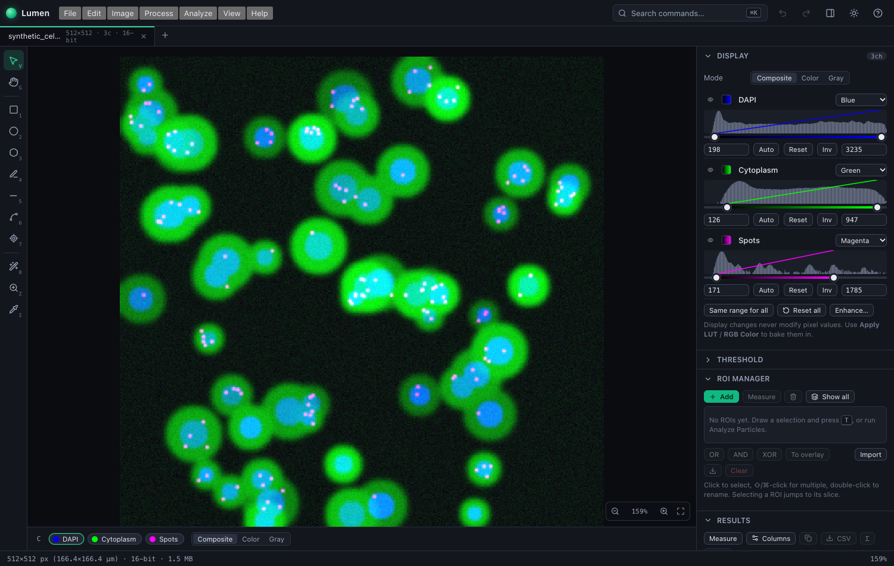
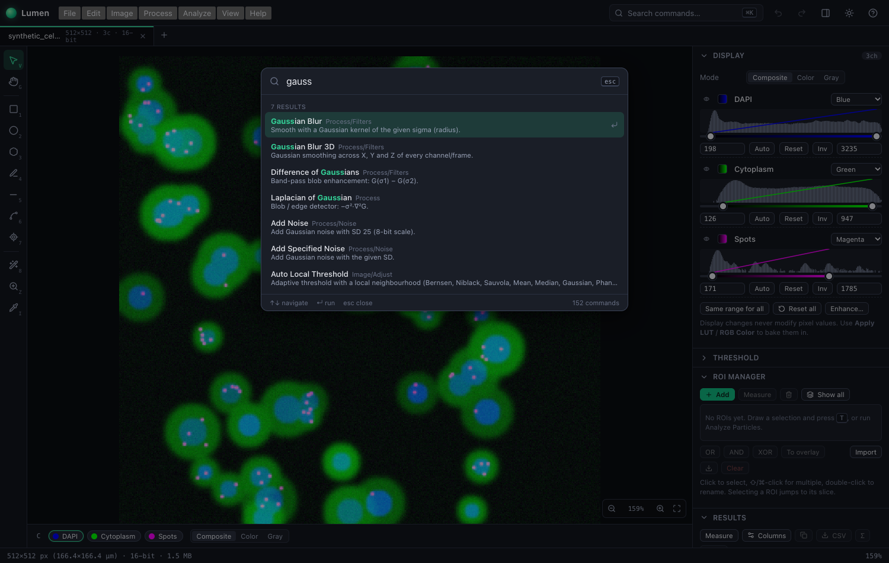
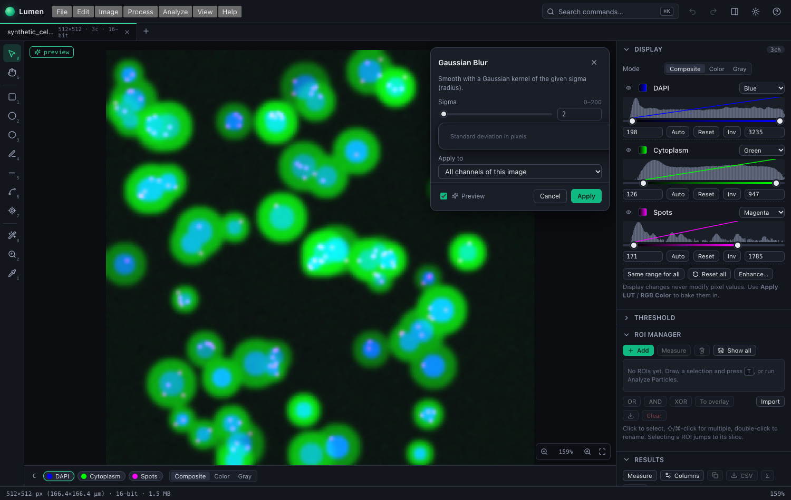
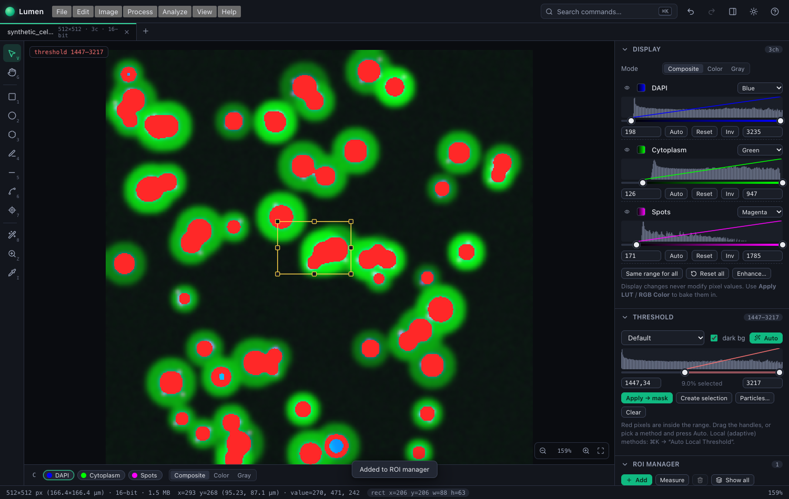
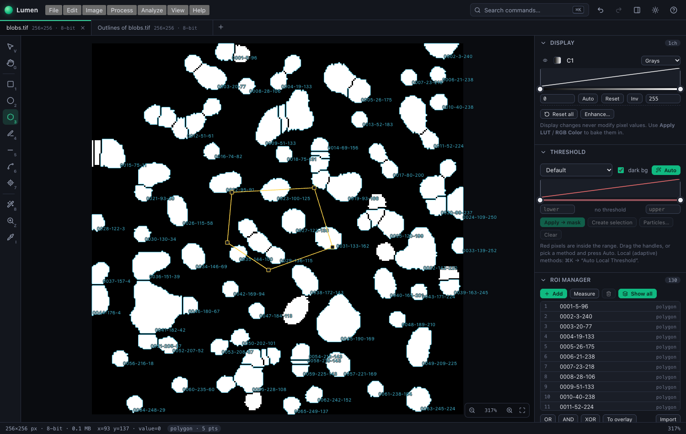

# Lumen

**The ImageJ / Fiji toolbox behind a single-window, keyboard-first interface.** · [github.com/Jetzu/Lumen](https://github.com/Jetzu/Lumen)

Lumen re-implements the scientific image-analysis functionality of Fiji on top of numpy,
scipy, scikit-image and scikit-learn, and wraps it in a modern browser UI: one window, image
tabs instead of floating windows, a command palette that finds any of its 503 commands,
live previews for filters and adjustments, per-channel display controls with histograms, a docked
ROI manager and results table, 3-D volume rendering and orthogonal views, deep (memory-bounded)
undo with a visible history, a Python console with an always-on macro recorder (exports Python, JavaScript or ImageJ macros), and an ImageJ-macro
compatibility layer that runs pasted Fiji macros; how this GUI compares with Fiji's, task by task,
is measured in [docs/USABILITY.md](docs/USABILITY.md).



## Why

Fiji's analysis toolbox is excellent, but its interface is a 1990s desktop app: 348 built-in
commands plus nearly 1,000 Fiji plugins in nested menus, every image / dialog / table in its own
floating window, modal dialogs without preview, one level of undo, and four separate
"adjust" tools that must be re-opened per image. Lumen keeps the toolbox and fixes the
interface. See [docs/DESIGN.md](docs/DESIGN.md) for the research and design principles.

How much that helps was measured rather than asserted: [docs/USABILITY.md](docs/USABILITY.md)
walks ten everyday tasks (adjust channels, threshold and count, measure, project, composite,
filter and undo, track and export, find a command, batch a folder, compare two images) through
Fiji's documented paths and through the running Lumen app with a browser script. The documented
Fiji paths need 84 clicks/keys and 20 windows; Lumen needs 54 and none. The same document is
frank about where Fiji is still ahead (plugins, Bio-Formats, script languages, data larger than
RAM, community) and proposes the user study that has not been run yet.

## Install & run

Requirements: Python ≥ 3.11 (Node is only needed to rebuild the frontend).

```bash
cd Lumen
python -m venv .venv && source .venv/bin/activate      # or: uv venv && source .venv/bin/activate
pip install -e .                                        # or: uv pip install -e .
lumen                                                   # opens http://127.0.0.1:8765 in your browser
lumen path/to/image.tif other.nd2                       # open files at startup
lumen --window                                          # quick native window (pip install pywebview)
```

**Fiji plugins.** Plugins ▸ Utilities ▸ Fiji Update Site… reads Fiji update sites; installed plugin jars become commands under Plugins ▸ Fiji and run with the real ImageJ through the Java bridge (needs a JDK and an installed Fiji; see docs/SCRIPTING.md). Lumen's own commands stay pure Python and need neither.

**Desktop app.** Lumen also comes as a desktop application: its own window and Dock / taskbar icon, native Open and Save
dialogs, images that open from Finder or Explorer (double-click, *Open With*, drop on the Dock icon), one running
instance, a quit warning for unsaved images. Build it with `python3 desktop/build.py` (macOS: `Lumen.app` and a DMG in
`desktop/dist/`; Windows and Linux builds through `.github/workflows/desktop-release.yml`), or run the window from source
with `python3 desktop/run_dev.py`. See [docs/DESKTOP.md](docs/DESKTOP.md).

**AI assistants (MCP, Agent Chat).** Click **✻ Agent** in the top bar to chat with Claude Code or Codex inside Lumen (the ChemDraw MCP's Agent Chat panel, dark and light). Lumen also includes an MCP server, so Claude Code, Claude Desktop, Codex or any other MCP client can work in the Lumen you have open. It can open images, run any command, ImageJ macro or script, measure, manage ROIs and read results, and everything it does appears live in your window. It also sees your selection, tool and open dialog. Run `lumen-mcp` (`pip install -e ".[mcp]"`) or the desktop app's `Lumen --mcp`; `Lumen --mcp-install` (or `lumen-mcp --install`) registers it with Claude Code, Codex and Claude Desktop. See [docs/MCP.md](docs/MCP.md).

Optional extras: `.[dev]` (pytest, httpx, playwright, mcp), `.[mcp]` (the MCP server), `.[formats-extra]` (astropy, pynrrd, bioio, SimpleITK),
`.[ml]` (cellpose, stardist), `.[window]` (pywebview). `pip install -e ".[formats]"` adds Nikon ND2, Zeiss CZI, Leica LIF, Olympus OIB/OIF,
DICOM, NIfTI, MRC, HDF5/Imaris, OME-Zarr, XLSX export and `olefile` (faster Zeiss ZVI). Gatan DM3/DM4, Zeiss ZVI and
Leica LEI are read natively; every remaining proprietary format (Olympus VSI, SlideBook, Amira, …) opens through the
optional Java Bio-Formats bridge `pip install -e ".[bioformats]"` plus a JDK (see [docs/PLATFORMS.md](docs/PLATFORMS.md)).
Video (AVI/MP4) needs `pip install -e ".[video]"`; see the security note below before installing it.

### Platforms

Lumen runs on macOS, Linux and Windows (Python 3.11 – 3.14; every dependency ships as a wheel, so no compiler is
needed). On Windows: `py -3 -m venv .venv`, `.venv\Scripts\activate`, `pip install -e .`, then `lumen` – or run
`scripts\run_lumen.bat` (`scripts/run_lumen.sh` on macOS/Linux), which creates the venv and starts Lumen in one step.
Recent files, plugins and the sample cache live in `~/.lumen` (`C:\Users\<you>\.lumen` on Windows); set `LUMEN_HOME`
to move that folder. Browser, proxy, firewall and troubleshooting notes per platform: [docs/PLATFORMS.md](docs/PLATFORMS.md).
CI runs the test-suite on all three platforms.

### Security and macOS notes

- Lumen is pure Python plus signed, pre-built wheels (numpy, scipy, scikit-image, …). It contains no
  native executables of its own and by default listens only on `127.0.0.1` (your machine), never on the network
  unless you pass `--host`.
- The optional `[video]` extra installs `imageio-ffmpeg`, which ships an **unsigned `ffmpeg` binary**. On
  macOS, Gatekeeper may show "Apple could not verify … is free of malware" the first time it runs. That is
  why video support is opt-in and not installed by default.
- Plugin files in the plugins folder, macro/script files you run, and saved classifier models (`.joblib`, a
  pickle) execute code when loaded: only load files from people you trust, exactly as with Fiji plugins and
  Weka `.model` files.
- macOS may ask whether *Python* may access your Desktop, Documents or Downloads folder when you browse
  there in the Open/Save dialog, and (if the application firewall is on) whether Python may accept
  incoming connections. Both prompts refer to the Python interpreter running Lumen; answering "Don't allow"
  to the network prompt is fine because Lumen only talks to your own browser over localhost.

Rebuilding the UI after editing `frontend/`:

```bash
cd frontend && npm install && npm run build            # output goes to lumen/static/
npm run dev                                             # hot-reloading dev server on :5173 (proxies to :8765)
```

Tests: `pip install -e ".[dev]"` then `pytest` (1242 tests covering the engine, formats, tracking, registration, segmentation, 3-D analysis, MorphoLibJ-style label tools, batch, workflows, performance bounds, ImageJ compatibility and the HTTP API, in about a minute; 3 skip without the optional format libraries). Browser end-to-end tests live in `tests/e2e` and run against the installed Google Chrome (see [tests/e2e/README.md](tests/e2e/README.md)); they skip when Playwright is absent.

## What's in the box

| Area | Commands |
|---|---|
| **File** | TIFF / OME-TIFF (ImageJ hyperstacks with calibration, LUTs, ranges, labels), LSM, STK, PNG, JPEG, BMP, GIF, WebP, PNM, NPY, ND2, CZI, LIF, OIB/OIF, DICOM, NIfTI, MRC, HDF5/Imaris, OME-Zarr, video, raw and text images, image-sequence folders, drag & drop, server-side file browser, recent files, open next/previous, the 29 classic ImageJ samples (downloaded on demand), ImageJ `.lut` and `.roi`/`.zip` files, revert; export TIFF / OME-TIFF / PNG / JPEG / GIF / video / NIfTI / HDF5 / OME-Zarr / ZIP / LUT / text / CSV / XLSX / ROI JSON / TrackMate XML / OBJ-STL-PLY meshes |
| **Display** | Per-channel min/max with histogram slider, 60 LUTs (the complete Fiji set, byte-identical, plus perceptual maps), composite / single / grayscale, invert LUT, channel chips, Z and T sliders with playback, zoom to cursor, downsampled fetching for large images, split view to compare two images side by side with linked pan/zoom |
| **Selections** | Rectangle (optionally rounded), oval, polygon, freehand, line, segmented line, points, wand; move/resize/vertex editing; enlarge, band, convex hull, fit ellipse / circle / rectangle / spline, inverse, interpolate, bounding box, rotate, scale, line ↔ area, create mask ↔ selection, image to selection, select bounding box, properties, specify, restore |
| **Edit** | Fill, clear, clear outside, draw, invert, cut / copy / paste with ImageJ's 15 transfer modes, copy to the system clipboard, preferences (fonts, colours, points, arrows, plots, I/O, appearance), custom keyboard shortcuts, deep undo / redo (memory-bounded) with history list |
| **Image** | 8/16/32-bit, RGB, 8-bit colour (indexed), RGB/HSB/Lab stacks, crop, auto crop, duplicate, scale, rotate, flip, translate, shear, perspective, landmark (rigid/similarity/affine/projective) and polar transforms, canvas size, bin, properties / set scale, split & merge channels, arrange channels, channel names, show / edit / import LUTs, image ↔ results, overlay (add, image overlays, grid, from manager, scale bar, flatten, remove) |
| **Stacks** | Z / T projection (max, min, mean, sum, SD, median), grouped projection, substack, make subset, reduce dimensionality, hyperstack ↔ stack, add/delete/reverse slices, slice labels, montage ↔ stack, concatenate, combine, insert, re-order hyperstack, reslice (orthogonal, along a line, radial), stack statistics, Z/T profile, ROI interpolation between keyframes |
| **Process** | Gaussian (2-D, 3-D), median, mean, min, max, variance, unsharp mask, convolve, top-hat, DoG, LoG, bilateral, non-local means, ROF, Frangi, shape index, smooth, sharpen, find edges, shadows, 3-D rank filters, enhance contrast, CLAHE, normalize local contrast, retinex, rolling-ball / sliding-paraboloid background subtraction, FFT with inverse FFT, custom filters, swap quadrants, FD math and band-pass, image calculator, math (add … expression, ImageJ-style macro), noise (add, salt & pepper, despeckle, remove outliers / NaNs), optical flow |
| **Threshold** | Interactive panel with red overlay; 16 global auto methods (Default, Huang, Intermodes, IsoData, Li, MaxEntropy, Mean, MinError, Minimum, Moments, Otsu, Percentile, RenyiEntropy, Shanbhag, Triangle, Yen); 7 local methods (Bernsen, Niblack, Sauvola, Phansalkar, mean, median, Gaussian) |
| **Binary** | Make binary, erode, dilate, open, close, outline, fill holes, skeletonize (4 methods), distance map (2-D, signed, 3-D), ultimate points, watershed (distance-transform or ImageJ EDM/UEP), Voronoi, dither, binary median, remove small objects, label components, convex hull |
| **Analyze** | Measure (19 ImageJ measurement sets incl. Feret, shape descriptors, fit ellipse), measure stack, set measurements, analyze particles (size / circularity filters, outlines / masks / count masks, summary, ROI manager), histogram, plot profile, find maxima (prominence, 6 output modes), summarize, distribution, measure labels, colocalization, ROI manager (combine OR/AND/XOR, measure, import/export, show all) |
| **Tracking** | TrackMate-style spot detection (LoG / DoG / maxima, sub-pixel, quality and intensity features), spot and track filters on any feature, nearest-neighbour / simple LAP / full LAP linking with gap closing, splitting and merging (lineage trees), a step-by-step wizard, TrackScheme lineage graph with split / link / unlink / delete / undo editing, manual tracking tool, track overlays with colour-by-feature and tail modes, per-track statistics, Spots / Edges / Tracks tables, TrackMate XML import/export with lineage edges, CSV export, kymographs |
| **Registration & stitching** | Stack alignment along Z or T with three estimators (phase correlation + features, SIFT feature matching with Fiji's options, StackReg/TurboReg-style intensity pyramid optimisation) for translation / rigid / scaled rotation / affine / bilinear, descriptor-based registration in 2-D and 3-D and over series, manual landmark registration, SIFT / MOPS / ORB / block-matching correspondences, elastic (optical-flow) alignment, bUnwarpJ B-spline registration (Fast / Accurate / Mono, consistency, landmarks, Fiji-compatible transform files), moving least squares and landmark-correspondence warps, elastic montaging, folder registration, drift correction, channel alignment, phase correlation, Grid/Collection stitching (grid, positions from file, unknown positions, 3-D tiles, all fusion methods, TileConfiguration output) |
| **Segmentation** | Trainable (Weka-style) random-forest pixel classifier trained from named ROIs with probability maps, random walker, Chan–Vese and morphological active contours, superpixels (SLIC, Felzenszwalb, Quickshift, compact watershed), multi-Otsu, seeded watershed, colour clustering, label editing (expand, shrink, filter, merge, border removal), labels ↔ ROIs, Cellpose / StarDist bridges when installed |
| **3-D** | WebGL volume rendering (MIP, translucent, iso-surface) and mesh surfaces (marching cubes with smoothing, wireframe, OBJ/STL/PLY export, surface area and volume measurement) with per-channel cut/gain, orbit/zoom/pan, orthoslices, landmarks with calibrated distances, multi-image scenes (per-object colour, transparency, threshold, transform; save / load), view presets, perspective / orthographic, lights and clipping, turntable and freehand animation recording (stack or GIF) and supersampled snapshots; orthogonal XZ/YZ views that follow the cursor; 3D Project rotation series; reslice |
| **Annotation tools** | Brush, bucket fill, text, arrow and angle tools with a colour picker (HSB wheel, RGB / hex, pick from image), gradients, overlays for text (bold), arrows, tracks, calibration bars, time stamps and scale bars with Overlay Options (default fill, stroke, labels), measure overlay, burn-in to pixels, screen / window capture and capture of the current view, zoom to selection, synchronized and split views |
| **More analysis** | Analyze Skeleton (branches, junctions, lengths, pruning), Costes colocalization (auto-threshold, Manders, randomisation test), directionality, compare images (SSIM, PSNR, correlation), analyze line graph, color threshold (HSB/RGB/Lab/YUV), window/level, intensity calibration (12 functions), curve fitting (17 models), fractal box count, surface plot, gel lanes (select, plot, label peaks), multi-measure, straighten, 3D project, stack histogram, set-measurements options (invert Y, NaN cells, labels, overlay) |
| **Batch** | Process a folder (or replay the recorded macro) over any number of files with per-file results, output formats and error reporting; batch measure; run a script on all open images |
| **MorphoLibJ-style label analysis** | Analyze Regions 2-D and 3-D (area / volume, Crofton perimeter / surface, circularity / sphericity, Euler number, bounding box, centroid, equivalent ellipse / ellipsoid, elongation, convexity, Feret, oriented box, geodesic diameter, tortuosity, inscribed circle / sphere, mean breadth, with overlays), intensity measurements (2-D / 3-D), microstructure analysis (area / perimeter / volume / surface / Euler densities), labels to RGB, assign measure to label, label editing (select, remove, merge, grow / shrink, fill holes, size opening, keep largest, border removal, as a guided workflow with a click-to-remove tool), region adjacency graph, label overlap measures (Jaccard, Dice …), morphological filters with every element shape (2-D / 3-D), regional / extended / imposed minima and maxima, chamfer and geodesic distance maps, marker-controlled watershed, reconstruction, kill borders, area opening, directional filtering, binary and label overlays, morphological segmentation |
| **Pixel classification** | Weka-style trainable segmentation with a trace GUI (classes with colours, pen / brush traces), seven classifiers (random forest, extra trees, gradient boosting, SVM, k-NN, logistic regression, MLP), Weka's 20 feature groups with sigma ranges, probability maps / labels / transparent overlays, apply to a plane, stack, other image or folder, save / load models, feature importances; the same in 3-D |
| **3-D analysis** | 3-D trainable pixel classifier, 3-D rigid / affine and descriptor-based registration of stacks, 3-D Analyze Skeleton (26-connected tracing, pruning, longest shortest path), 3-D distance maps and rank filters, 3-D region analysis, mesh measurement |
| **Workflows & jobs** | Guided workflows (count nuclei, colocalise, track cells, measure intensity over time …) that walk through the right commands with the current image; every long command reports progress and can be cancelled; a memory monitor and job list in the inspector |
| **ImageJ compatibility** | `IJ.run("…", "options")` with 466 command names (aliases included; no declared-unsupported commands), Bio-Formats `Ext.*` macro extensions, Weka `call()` statics and 172 macro functions, an ImageJ-1 macro-language runner (variables, loops, functions, arrays, ROI manager, results), byte-exact `.roi` / `.zip` ROI files, ImageJ TIFF display-state round trip (written as `ImageJ=1.54p`, with a processing log – every History step with its parameters, *Derived from*, *Source* – in the Info tag that Fiji shows under Image ▸ Show Info) |
| **Bio-Formats-style import / export** | Importer dialog (series chooser, open all series, colour mode, view and stack order, autoscale, split C / Z / T, group files, virtual, range, crop, swap dimensions, pyramid level, metadata and OME-XML tables) over the native readers incl. multi-series OME-TIFF, whole-slide pyramids (SVS, NDPI, SCN, BIF), ND2 positions, CZI scenes, LIF, HDF5/Imaris, OME-Zarr, plus Gatan DM3/DM4, Zeiss ZVI and Leica LEI natively and every other proprietary format through the optional Java Bio-Formats bridge; remote importer; exporter with compression and one-file-per-plane; TIFF virtual stacks (memory-mapped or on demand); macro `Ext.*` extensions and Stack Slicer |
| **Scripting & plugins** | Script editor for Python, ImageJ macros and JavaScript (sandboxed in-browser runtime with a `lumen` API, open / save, run selection), Python console with `lumen` API, numpy, scipy, scikit-image; every applied command is recorded as a runnable Python or JavaScript script; plugin commands and plugin *tools* (tool-rail tools that receive clicks and drags) from `*.py` files in `~/.lumen/plugins` (or `LUMEN_HOME/plugins`), hot-reloaded by *Reload Plugins*; text windows and tables; a REST + WebSocket API for external tools (see [docs/SCRIPTING.md](docs/SCRIPTING.md)) |

The complete list with parameters is in [docs/COMMANDS.md](docs/COMMANDS.md); step-by-step recipes for
common biology tasks (verified scripts) are in [docs/WORKFLOWS.md](docs/WORKFLOWS.md).

## Using it

- **⌘K** opens the command palette. Type part of a name ("gauss", "z proj", "particles").
- Commands with parameters open a **sheet** at the top-right of the viewport. Toggle *Preview*
  to see the result on the current plane while you drag sliders; *Apply* commits it and
  records an undo step.
- The right-hand **inspector** holds Display, Threshold, Workflows, 3-D View, Orthogonal Views,
  Tracks, ROI Manager, Results, Plot, Histogram, Table, Image Info, History, Script & Recorder,
  and Log. Sections collapse, reorder and remember their state; the inspector is resizable.
  Nothing ever opens in a separate window.
- Long commands show a progress bar with a cancel button; **⇧⌘\\** opens a split view to compare
  two images; **⌘,** opens Preferences; **⌘P** prints the current view.
- ImageJ's single-letter shortcuts work: **M** measure, **T** add to ROI manager, **H**
  histogram, **K** plot profile, **A** select all, **F** fill, **B** add to overlay,
  **⇧X** crop, **⇧D** duplicate. Press **?** for the full list.
- Tools: **1**–**8** select the drawing tools, **V** pointer, hold **Space** to pan,
  wheel zooms at the cursor, **⇧ wheel** scrolls slices, **,** / **.** step slices.






## Architecture

```
lumen/core/image.py      LumenImage – (T, Z, C, Y, X) numpy hyperstack + calibration + display
lumen/core/registry.py   @op decorator: parameter schema → palette, menus, auto-generated UI, recorder, scripting
lumen/core/ops/          the command library (filters, math, threshold, binary, stacks, analyze, …)
lumen/core/measure.py    ImageJ-compatible measurements
lumen/core/threshold.py  auto-threshold algorithms on 256-bin histograms
lumen/core/session.py    open images, results, ROI manager, undo, recorder
lumen/server/app.py      FastAPI REST + WebSocket API, serves the built frontend
frontend/src/            React + TypeScript UI; client-side compositing of raw planes
```

Planes travel to the browser as raw typed arrays; brightness, contrast, LUTs and channel
compositing happen on the client, so display adjustments are instant and never touch
the server. Processing runs in numpy / scipy / scikit-image on the server.

### Adding a command

```python
# ~/.lumen/plugins/my_filter.py
from lumen.core.registry import op, Param
from scipy import ndimage as ndi

@op("plugins.my_blur", "My Blur", "Plugins", description="Uniform filter",
    params=[Param("size", "int", 5, min=1, max=50)])
def my_blur(plane, ctx, size=5):
    return ndi.uniform_filter(plane, size)
```

Run *Plugins ▸ Utilities ▸ Reload Plugins* (or restart Lumen) and "My Blur" appears in the
palette, the Plugins menu, the scripting API and the recorder, with a live preview and undo,
for every image type and stack scope. Progress and cancellation are available to any command
through `ctx.progress(fraction, message)` and `ctx.check_cancel()`.

## How complete is it?

[docs/FIJI_PARITY.md](docs/FIJI_PARITY.md) maps every Fiji/ImageJ menu command to Lumen:
of 311 menu rows, 276 are fully covered by a command and 35 by a UI feature; none are partial
or missing. The two formerly partial rows now work through Java subprocesses over an installed Fiji's
jars plus a JDK, with no Python extra: proprietary microscope formats beyond the native readers (which
include Gatan DM3/DM4, Zeiss ZVI and Leica LEI) open through Fiji's Bio-Formats jars, and Groovy,
BeanShell, Rhino JavaScript and JRuby scripts run with the real `ij.jar` in batch mode, verified
bit-exact against Lumen's own filters on this Mac; Python (including Fiji-style Jython scripts through an
`ij` shim), ImageJ macros and JavaScript need no Java at all. ImageJ macro-language tools and docked
plugin frames are supported. The ImageJ-macro layer maps 466 `run("…")` command names and 172
macro functions. How closely the commands compute the same numbers as ImageJ itself is measured in
[docs/CROSSVALIDATION.md](docs/CROSSVALIDATION.md): 277 macro cases run unchanged by the real ImageJ 1.54p
and by Lumen – 275 exact, 1 within a stated tolerance (the Stack Statistics row that ImageJ
prints with three decimals) and 1 recorded ImageJ batch-mode artefact (`tests/crossval`, opt-in).
The research behind the design, with sources, is in
[docs/RESEARCH.md](docs/RESEARCH.md); a comparative usability assessment (seven heuristic
evaluations – four by the assistant that built Lumen and three by other models that had not read
them, run on the fixed build – plus measured interaction counts; every round's problems were fixed
and then re-walked by the evaluators who found them, three times, each re-walk listed with what it
confirmed, what it still found and what was fixed next; a user-study kit is included, no human
study has been run) is in [docs/USABILITY.md](docs/USABILITY.md).

The code was reviewed by independent adversarial review passes (every finding verified
by two further agents before being fixed); the regression tests for those fixes are part
of the suite.
